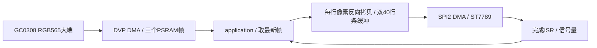

# 摄像头实时预览实现方案

更新日期：2026-10-12。当前版本 v1.0 已实现、编译并烧录至 COM4。用户确认“左右已正常，画面流畅”；当前验证结果见 test-report.md。

## 依据与目标

已阅读 AGENTS.md、docs/AGENTS_CN.md、docs/ARCHITECTURE.md 和历史板级 GPIO 记录，未修改 docs 目录。docs/REQUIREMENTS.md、docs/DESIGN.md、docs/TEST.md 当前不存在。

本版为 GC0308 → ESP32-S3 → ST7789 本地实时预览：320×240 横屏，上电自动显示，不需要网络。目标显示 ≥20 FPS，最低验收 15 FPS，上电首帧 ≤3 秒。端到端延迟 ≤150 ms 为待实测目标，串口 display_ms 不等于曝光到屏幕的延迟。首版不包含音频、录像、触摸和电池管理。

## 架构与文件

| 文件 | 职责 |
|---|---|
| main/test.c | app_main 调用 ApplicationStart |
| main/application.c/.h | 初始化、预览、恢复、错误状态和统计 |
| main/boards/atk_box3/board.c/.h | I2C、AW9523B 身份、供电、复位、背光 |
| main/camera/camera_capture.c/.h | V4L2 采集、格式校验、超时、帧归还及停流 |
| main/display/lcd_display.c/.h | ST7789、DMA 条缓冲、左右修正与传输完成同步 |
| tools/idf-env.ps1 | 本机 ESP-IDF 工具链入口 |
| tools/serial_verify.py | 有界串口日志采集及 JSON 统计 |

按现有架构分离板级、显示、采集和高层行为。本版状态转换集中在 application.c，未创建空的状态机文件。采用单任务管理帧所有权，DMA 中断只发信号；这取代初稿双任务邮箱，减少同步复杂度。GC0308 原生 RGB565 输出取代初稿 YUV 软件转换，实际验证后优先保持这条较短的数据路径。

## 硬件与依赖

esptool 实测 ESP32-S3 revision v0.2、16 MB Flash、8 MB 内置 PSRAM；日志确认 Octal PSRAM 80 MHz、自检通过。扩展器 0x59 读到 AW9523B ID=0x23；GC0308 PID=0x9b。

| 接口 | 配置 |
|---|---|
| 共用 I2C | SDA GPIO3、SCL GPIO2，100 kHz，摄像头复用句柄 |
| 摄像头 D0～D7 | GPIO7、8、9、10、11、12、4、5 |
| 摄像头同步 | VSYNC6、DE/HREF46、PCLK45 |
| 摄像头供电/复位 | XIO14 / XIO15；低 50 ms，释放后等待 50 ms |
| 主供电/背光/功放 | XIO11 开，XIO8 低有效背光，XIO5 功放关闭 |
| LCD SPI2 | SCLK15、MOSI16、MISO17、CS47、DC48，mode 0，60 MHz |
| LCD 方向及颜色 | swap_xy=true、mirror_x=true、mirror_y=false、invert_color=true、RGB565 大端 |

AW9523B 输出寄存器为 0x02/03、方向为 0x04/05、GPIO/LED 模式为 0x12/13。历史 TCA95xx 驱动把 0x06/07 用作方向，实际在 AW9523B 上属于中断配置；本版依据芯片身份使用正确寄存器，对必要位读改写并读回校验，保留未使用端口，未照搬全部端口输出掩码。

本机工具链 ESP-IDF v6.1，esp_video 2.5.0、esp_cam_sensor 2.6.0，完整依赖由 dependencies.lock 锁定。本次验证本机 v6.1 安装，换版本需重新验证。组件管理器下载源码至被忽略的 managed_components。

采集格式为官方 RGB565_BE_320x240_20fps_subsample，V4L2 FourCC RGBR（RGB565X）、stride=640、153,600 B/帧。实际 FPS 用日志统计，不把格式名的 20fps 当实测。XCLK 引脚 NC，使用板上时钟；历史配置频率 24 MHz，格式表标称 20 MHz，未用示波器测量实际频率。

参考：[板厂扩展 IO 示例](https://wiki.alientek.com/docs/Boards/IoT/DNESP32S3B3/example-idf/iic_exio/)、[AWINIC 身份寄存器说明](https://www.awinic.com/cn/faq.html?title=9523)、[esp_video 官方组件](https://components.espressif.com/components/espressif/esp_video/versions/2.5.0/readme?language=en)。

## 初始化和帧生命周期

启动：检查 PSRAM → 创建 I2C → 验证 AW9523B 并设置供电 → 初始化 SPI/LCD → 短暂红绿蓝诊断 → 摄像头复位、探测和格式验证 → 映射三帧并排队 → 开始采集与显示。

CameraGet 成功后应用取得借用帧，必须 CameraReturn 恰好一次。索引、长度、容量、步长和错误标志检查后才能读取；无效帧也须归还。摄像头组件拥有 MMAP 实际内存，停流、close 设备、esp_video_deinit 后清空指针，不对组件分配调用 free/munmap。

显示前最多非阻塞替换两张已完成的旧帧，每张丢弃帧归还；随后恢复 1 秒 dequeue 超时，避免无限排队。采集错误或持续 1 秒没有有效帧，停止并重建摄像头；运行期累计最多恢复 3 次，失败进入 ERROR 并显示红色诊断图。LCD 超时停止预览并保留 DMA 缓冲，禁止释放或覆盖在途内存。

## 显示优化与方向修正

内部 RAM 双条缓冲各 320×40×2=25,600 B，共 50 KiB；一帧 6 条。最多一条在途，下一条拷贝可与上一条 DMA 重叠；提交前等待旧事务，最后一条完成后才归还摄像头帧。SPI 不直接访问采集 PSRAM 指针。

on_color_trans_done 仅释放 ISR 安全信号量，需要时显式 portYIELD_FROM_ISR；当前 SPI panel 驱动不消费回调返回值，仅返回 bool 不能保证立即唤醒。40 行条带和显式唤醒解除初次调试时的传输瓶颈。

用户确认画面左右颠倒。实物中传感器镜像位写入后读回仍为 1，最终不依赖该设置：按每行 x←319−x 反向复制完整 RGB565 像素，保持两字节大端顺序，不增加全帧内存或修改原帧。用户已确认修正版“左右已正常，画面流畅”。

## 预算、实施状态与验收

三帧采集 450 KiB PSRAM，加双 DMA 条缓冲 50 KiB 内部 RAM，共 512,000 B 显式像素存储，另计驱动、任务栈和描述符。20 FPS 像素流量 3,072,000 B/s，即 24.576 Mbit/s；60 MHz SPI 理论整帧下限 20.48 ms，实测耗时高于下限。

已完成板级、采集、显示、帧所有权、最新帧策略、异常恢复、统计、左右修正、编译、烧录和用户实物确认。10 分钟连续运行及 20 次 USB 复位启动通过，具体测量及最终镜像身份见当前测试报告。

2 小时连续运行、20 次断电冷启动、硬件故障注入和端到端高速录像计时属于后续扩展验收。软件复位不等于冷启动，display_ms 不等于端到端延迟。SPI 扫描可能撕裂，目前无 TE 同步，不承诺无撕裂。
